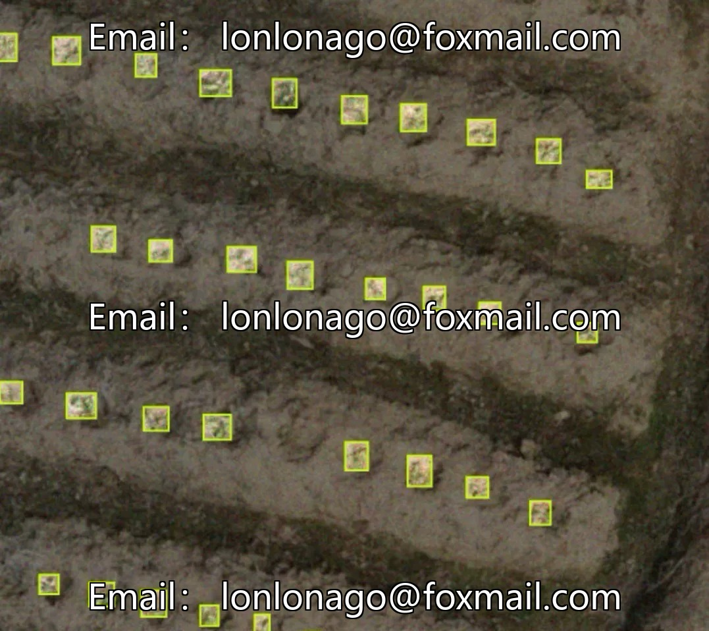
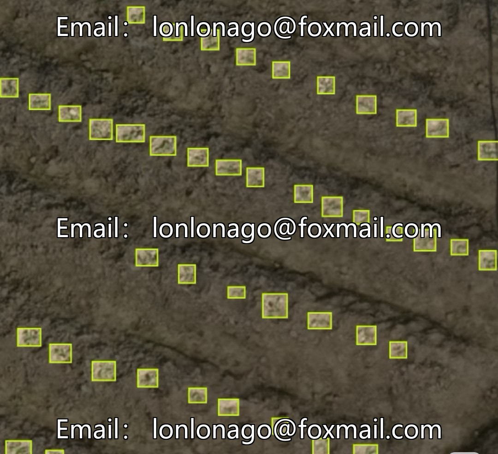
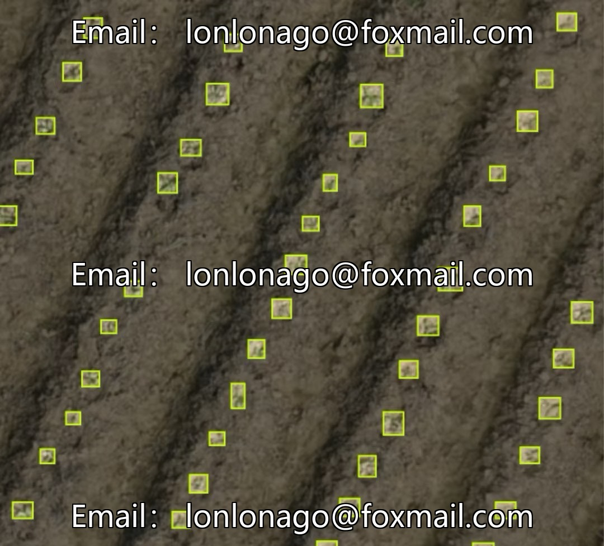
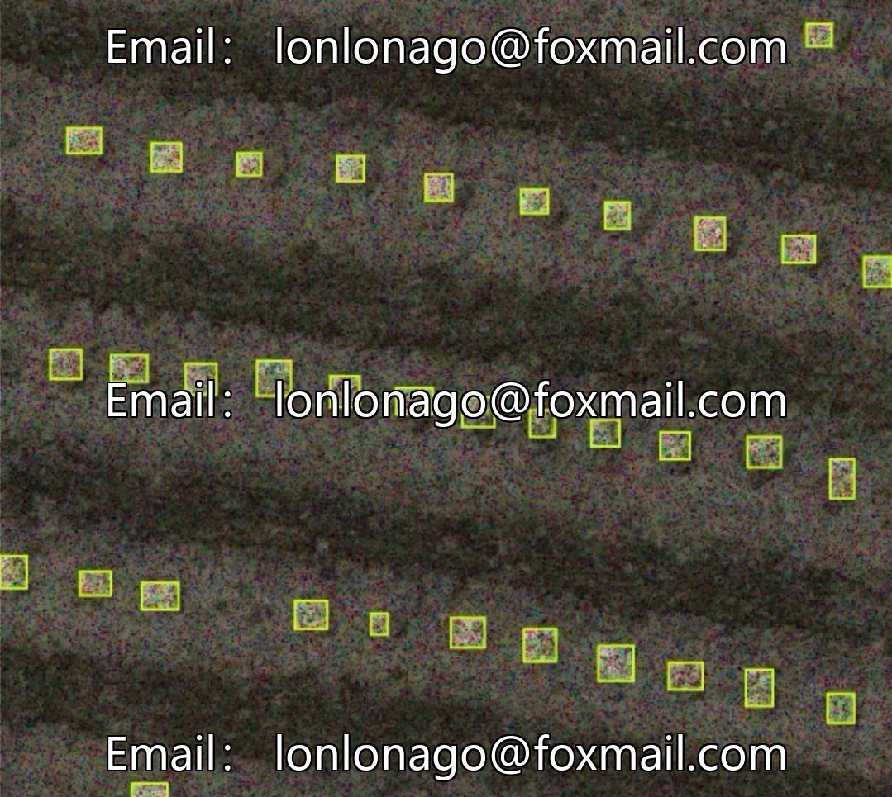

# Drone tobacco seedling inspection dataset 10545 period, for intelligent agriculture and target inspection.

## Body

Drone tobacco seedling inspection dataset 10545th period, aimed at smart agriculture and target detection tasks, containing 4600 images, labeled in YOLO format, with the target category being tobacco plants, suitable for inspections in farmland and outdoor complex planting environments.

The dataset is specifically constructed for the detection of tobacco seedling emergence rate, which has been uniformly organized and standardized. It supports the training of mainstream target detection models and algorithm validation, covering actual field lighting, terrain, and planting density differences. It is close to inspection scenarios and has strong practicality.

Can be used for drone field inspection, tobacco seedling rate statistics, plant density monitoring, development of intelligent agricultural identification systems, and research on deep learning algorithms.

Virtual materials, once sold, are non-refundable.
Interested friends, click "I want" to proceed.

## Images

## Payment

Here is a pay link on Stripe ( https://buy.stripe.com/3cs8yP7sY87d0vu9AB ). Please contact me lonlonago@foxmail.com after funding $89, and I will send you a complete data files , thank you!

